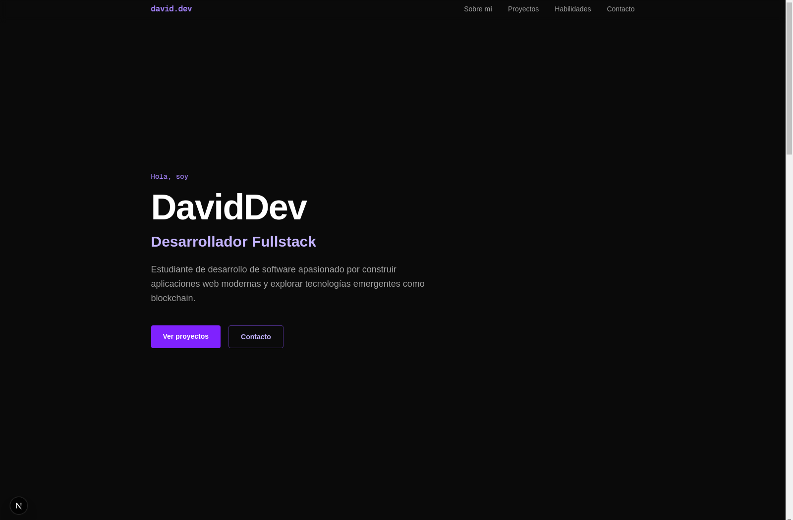
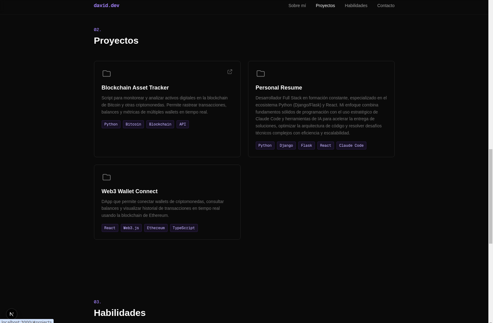
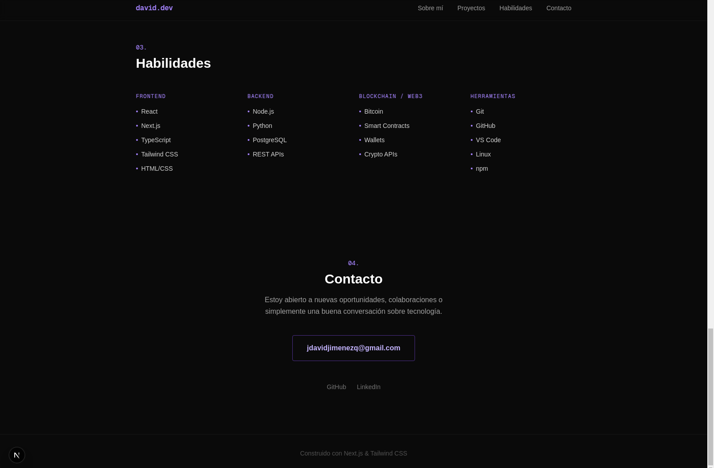

# Portfolio — David Jiménez

Portafolio personal de **David Jiménez**, desarrollador fullstack, construido con Next.js (App Router), TypeScript y Tailwind CSS.



## Características

- Diseño de una sola página con secciones: Hero, Sobre mí, Proyectos, Habilidades y Contacto.
- Navegación con scroll suave a cada sección desde una barra superior fija.
- Tema oscuro con acentos violeta y tipografía Geist (`next/font`).
- Totalmente responsive (móvil, tablet y escritorio).
- Renderizado estático (SSG) — carga rápida y fácil de desplegar.

## Stack

- [Next.js 16](https://nextjs.org) (App Router, Turbopack)
- [React 19](https://react.dev)
- [TypeScript 5](https://www.typescriptlang.org)
- [Tailwind CSS 4](https://tailwindcss.com)
- ESLint (`eslint-config-next`)

## Capturas

| Proyectos | Habilidades y contacto |
| --- | --- |
|  |  |

## Empezar

Requisitos: [Node.js](https://nodejs.org) 18.18+ (recomendado 20 LTS) y npm.

```bash
# 1. Clonar el repositorio
git clone https://github.com/coderblockch/portfolio.git
cd portfolio

# 2. Instalar dependencias
npm install

# 3. Arrancar el servidor de desarrollo
npm run dev
```

Abre [http://localhost:3000](http://localhost:3000) en tu navegador.

## Scripts

| Comando | Descripción |
| --- | --- |
| `npm run dev` | Inicia el servidor de desarrollo. |
| `npm run build` | Genera la build de producción. |
| `npm run start` | Sirve la build de producción. |
| `npm run lint` | Ejecuta ESLint. |

## Variables de entorno

Este proyecto no requiere variables de entorno ni claves de API para funcionar. Si añades servicios externos en el futuro, crea un archivo `.env.local` (ya ignorado por Git) y documenta las claves aquí. **Nunca subas secretos reales al repositorio.**

## Estructura del proyecto

```
app/
├── components/      # Navbar, Hero, About, Projects, Skills, Contact
├── globals.css      # Estilos globales y tema de Tailwind
├── layout.tsx       # Layout raíz y metadatos
└── page.tsx         # Composición de la página principal
docs/                # Capturas usadas en el README
public/              # Recursos estáticos
```

## Despliegue

La forma más sencilla de desplegar es con [Vercel](https://vercel.com/new). También funciona en cualquier plataforma que soporte Next.js (`npm run build` + `npm run start`).

## Licencia

Distribuido bajo la licencia MIT. Ver [`LICENSE`](LICENSE) para más detalles.
