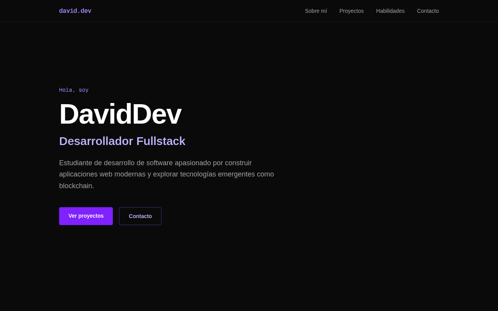

# 💼 Portfolio — David Jimenez

My personal developer portfolio: a single-page site that introduces me, lists my projects and skills, and shows how to contact me. Built with the **Next.js App Router**, **React**, **TypeScript**, and **Tailwind CSS**, and deployed on **Vercel**. Site content is in Spanish.

🔗 **[Live Site](https://portfolio-bay-nine-59.vercel.app)**



## Features

- Single-page layout with a fixed navbar that links to each section (About, Projects, Skills, Contact)
- **Hero** with a short intro and calls to action
- **About**, **Projects** (cards with description, tech tags, and link), **Skills** (grouped by area), and **Contact** sections
- Dark theme with a violet accent and responsive grids, built with Tailwind CSS utility classes
- Each section is its own reusable React component

## Tech Stack

- [Next.js 16](https://nextjs.org) (App Router)
- React 19
- TypeScript
- Tailwind CSS 4
- ESLint
- Deployed on [Vercel](https://vercel.com)

## Run Locally

Requires Node.js 20+.

```bash
git clone https://github.com/coderblockch/portfolio.git
cd portfolio
npm install
npm run dev
# then open http://localhost:3000
```

Other scripts:

```bash
npm run build   # production build
npm run start   # serve the production build
npm run lint    # lint the code
```

## Project Structure

```
portfolio/
├── app/
│   ├── layout.tsx        # root layout and page metadata
│   ├── page.tsx          # assembles the sections
│   ├── globals.css       # Tailwind and global styles
│   └── components/
│       ├── Navbar.tsx
│       ├── Hero.tsx
│       ├── About.tsx
│       ├── Projects.tsx
│       ├── Skills.tsx
│       └── Contact.tsx
├── public/               # static assets
└── docs/screenshot.png
```

## Author

**David Jimenez**, Sacramento, CA · [GitHub @coderblockch](https://github.com/coderblockch) · jdavidjimenezq@gmail.com
